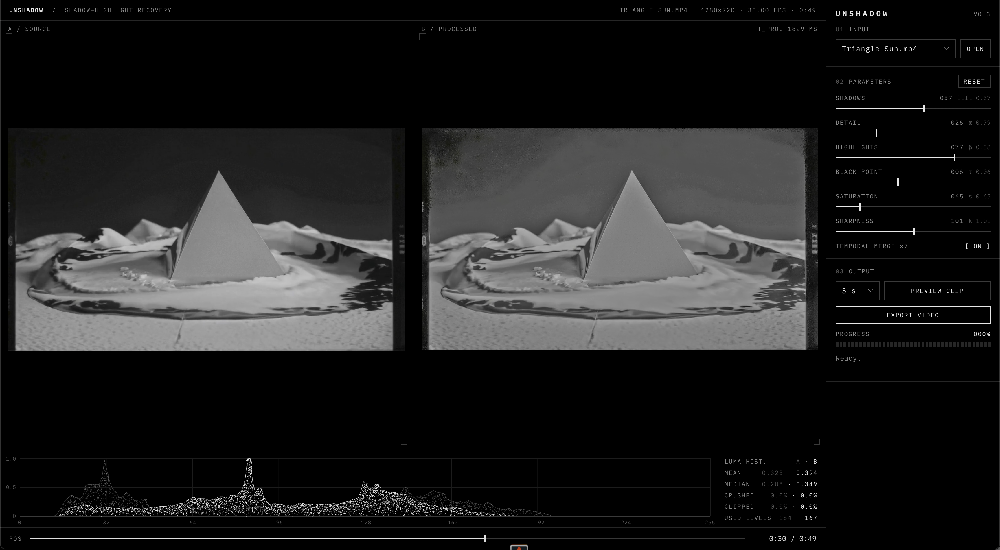

# Unshadow

A simple Shadow/Highlight editor for video, similar to Photoshop's Shadow/Highlight filter. It recovers detail from crushed shadows and blown highlights in low-quality, heavily compressed footage such as phone videos from concerts, and it keeps contrast and colour. Under the hood it does a two-stage clean-up of compression artefacts at 16 bits, merges 7 frames using motion compensation, applies a fast Local Laplacian Filter on max-RGB with one shared gain for R, G and B (so saturated stage colours do not burn), and finishes with colour-safe sharpening.



## Quick start

Double-click `Unshadow.command` (macOS). It starts the editor and opens it in your browser. Or run it by hand:

```bash
python3.11 src/editor.py          # then open http://127.0.0.1:8765
```

Command line, no UI:

```bash
python3.11 src/unshadow.py IN.mp4 OUT.mp4 [--lift 0.4 --detail 0.4 --range 0.5 --black 0.05 --sharpen 0.7]
```

## Requirements

- `ffmpeg` (for example `brew install ffmpeg`)
- Python 3.11 with `numpy` and `opencv-contrib-python`

## Editor

- **Before / after** frames side by side, plus a brightness histogram with mean, median, crushed and clipped values.
- **Parameters:** Shadows, Detail, Highlights, Black point, Saturation, Sharpness, and an on/off switch for the 7-frame temporal merge.
- **Preview clip:** renders 3, 5 or 10 seconds with the current settings and plays before and after in sync.
- **Export:** processes the full video and copies the audio. Output goes to `output/`.
- **Open:** opens any video file with the macOS file dialog. Videos in `test_videos/` are listed automatically.

## Environment variables (optional)

| Variable | Default | Meaning |
|---|---|---|
| `UNSHADOW_VIDEO_DIR` | `test_videos/` | Folder whose videos the editor lists |
| `UNSHADOW_PORT` | `8765` | Editor port |

No secrets are used.

## Demo video

```bash
python3.11 tools/make_demo.py samples/demo_stage.mp4
```

This generates a synthetic stage scene with crushed shadows, clipped spotlights and compression blocks. It contains no real footage.

## Tests

```bash
python3.11 tests/test_llf.py
```

## Limits

The tool reveals detail that is still in the file. It does not invent detail. Where a colour channel is fully clipped (for example, deep blue LED light at its maximum) or shadows were crushed to pure black before encoding, nothing can be recovered. We tested learned denoisers (SCUNet, FastDVDnet) on top of this pipeline: they only smoothed the image and added no visible structure.

## License

MIT. See [LICENSE](LICENSE).
